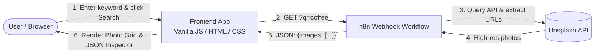

# Unsplash Lens 📸

A clean, modern, and responsive photo search application that connects directly to an automated **n8n workflow** to fetch high-resolution photography via the Unsplash API.

[](#getting-started)
[](https://n8n.io)
[](LICENSE)

---

## ✨ Features

- **⚡ Automated n8n Webhook Integration**: Directly queries the live n8n cloud webhook (`GET ?q=<keyword>`), eliminating the need for client-side API keys or a dedicated backend proxy.
- **🔍 Smart Keyword Search**: Search for topics like `coffee`, `nature`, `cars`, or `mountains` with keyboard submission (`Enter`) and quick-select tag chips.
- **🎨 Glassmorphic Dark UI**: Curated obsidian/indigo color palette, radial ambient light effects, Google Fonts (*Inter* & *JetBrains Mono*), and fluid micro-animations.
- **🖼️ Responsive Photo Grid**: Displays returned Unsplash images in an adaptive 3-column card grid with hover overlays, photo index badges, and lazy loading.
- **🔎 Lightbox Modal**: Click any photo or action button to open a high-resolution preview with loading indicator and direct external links.
- **💻 Live JSON Inspector**: Collapsible, syntax-highlighted drawer that renders the exact JSON response payload (`{"images": [...]}`) returned by n8n, complete with one-click clipboard copying.
- **🛡️ Resilient Error & State Handling**: Shimmer loading skeletons, empty query validation, graceful image load fallbacks (`onerror`), and screen reader accessibility (`aria-live`).

---

## 🔗 Architecture & API Flow



### Webhook Endpoint

```http
GET https://hopeu.app.n8n.cloud/webhook/a9bd47d1-aab4-4a9e-9605-7432f746ca10?q={keyword}
```

#### Example Webhook Response:
```json
{
  "images": [
    "https://images.unsplash.com/photo-1556740767-414a9c4860c1?crop=entropy&cs=srgb&fm=jpg&ixid=M3wxMTE0NTY3fDF8MXxzZWFyY2h8MXx8Y29mZmVlfGVufDB8fHx8MTc5MzA1MDc5M3ww&ixlib=rb-4.1.0&q=85",
    "https://images.unsplash.com/photo-1509042239860-f550ce710b93?crop=entropy&cs=srgb&fm=jpg&ixid=M3wxMTE0NTY3fDB8MXxzZWFyY2h8Mnx8Y29mZmVlfGVufDB8fHx8MTc5MzA1MDc5M3ww&ixlib=rb-4.1.0&q=85",
    "https://images.unsplash.com/photo-1783926014847-748a8074eb38?crop=entropy&cs=srgb&fm=jpg&ixid=M3wxMTE0NTY3fDB8MXxzZWFyY2h8M3x8Y29mZmVlfGVufDB8fHx8MTc5MzA1MDc5M3ww&ixlib=rb-4.1.0&q=85"
  ]
}
```

---

## 🚀 Getting Started

The project is completely self-contained with zero build steps or package dependencies.

### Prerequisites

Any modern web browser (Chrome, Firefox, Safari, Edge).

### Run Locally

1. **Clone the repository:**
   ```bash
   git clone https://github.com/samdajam/unsplash-lens.git
   cd unsplash-lens
   ```

2. **Serve with any local static server:**

   **Using Python:**
   ```bash
   python3 -m http.server 3000
   ```

   **Using Node (npx):**
   ```bash
   npx serve .
   ```

3. **Open in your browser:**
   ```
   http://localhost:3000
   ```

---

## 📁 Project Structure

```text
unsplash-lens/
├── index.html        # Semantic HTML5 markup, ARIA roles, and modal dialogs
├── styles.css        # Vanilla CSS design system, glassmorphism, tokens, and animations
├── app.js            # Webhook client, DOM rendering, lightbox, and JSON inspector
├── .gitignore        # Git ignore rules
└── README.md         # Project documentation
```

---

## 🛠️ Built With

- **HTML5** – Semantic layout and accessible structures
- **Vanilla CSS3** – Custom properties (design tokens), glassmorphism, responsive grid, keyframe animations
- **Vanilla JavaScript (ES6+)** – Native Fetch API, AbortController, clipboard API
- **n8n** – Workflow automation backend exposing the webhook
- **Unsplash API** – High-resolution photography source

---

## 👤 Author

**Sikander Al Masum**
- Website: [sikander.dev](https://sikander.dev/)
- GitHub: [@samdajam](https://github.com/samdajam)

---

## 📄 License

This project is open source and available under the [MIT License](LICENSE).
